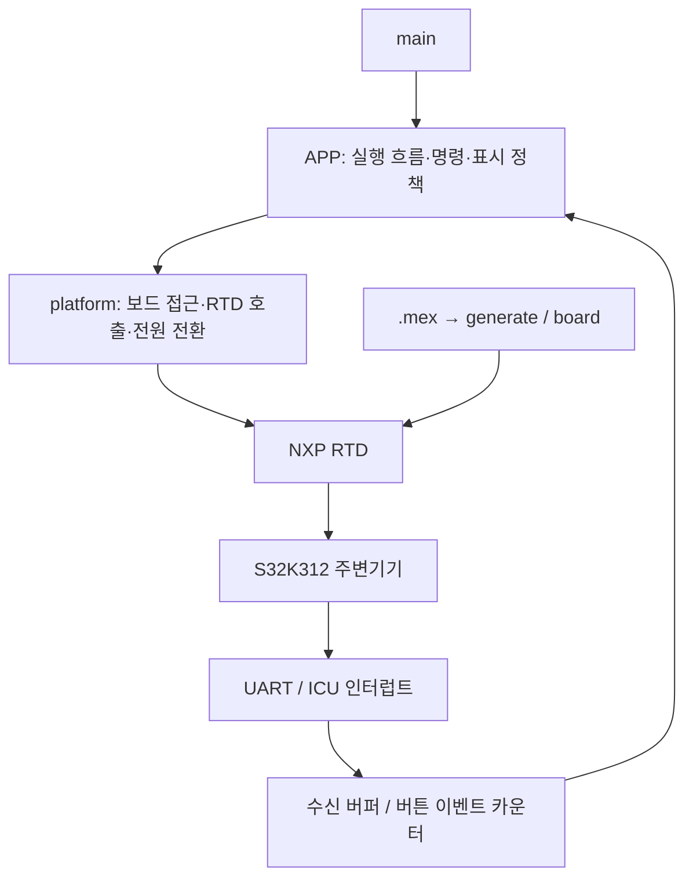

# S32K312 저전력 제어·진단 펌웨어

NXP S32K312에서 UART 명령, ADC/DMA 측정, LED/PWM 제어, Standby wakeup과 watchdog을 통합한 개인 임베디드 프로젝트입니다. RTD 주변기기 동작을 확인하는 코드에서 출발해, 애플리케이션 정책과 하드웨어 접근을 분리하고 인터럽트 처리 범위와 설정 의존성을 정리했습니다.

AUTOSAR 계열 NXP RTD API를 사용하는 **bare-metal superloop** 구조입니다. 기본 설정은 SW2로 깨우는 Standby 시연에 맞춰져 있습니다.

## 주요 기능

| 기능 | 구현 내용 |
|---|---|
| UART 명령 | LPUART6 인터럽트 수신, 링버퍼, 메인 루프의 명령 해석·실행 |
| ADC/DMA | 하드웨어 트리거 기반 ADC 결과 수집, non-cacheable DMA 버퍼 |
| 주기 진단 | STM0 1초 알림으로 부팅 후 경과 시간과 ADC 값 출력 |
| PWM | 버튼 폴링으로 0~100% 듀티를 10% 단계로 변경 |
| 색상 버튼 | ICU 이벤트를 메인에서 처리. 기본 설정에서는 Standby 요청, 시연 모드를 끄면 OFF → GREEN → BLUE 순환 |
| Standby | SWT0 정지, 주변기기·패드 정리, Standby 클록 전환, WKPU 외부 입력을 통한 깨우기 |
| 부팅 진단 | 초기화 전 reset/wakeup 상태 캡처, 재부팅 후 원인 출력 |
| Watchdog | 두 앱 프로필에서 SWT0 활성화, 메인 루프에서 갱신, Standby 진입 전에 정지 |
| 설정 검증 | 지원하지 않는 기능 조합을 전처리 단계에서 검출 |

## 개발 환경

| 항목 | 환경 |
|---|---|
| MCU / 보드 | S32K312 / S32K312 Mini EVB 기반 |
| CPU | Arm Cortex-M7 |
| IDE | NXP S32 Design Studio 3.6.8 |
| 드라이버 | S32K3 RTD 7.0.1 |
| 컴파일러 | NXP GCC 10.2 for Arm 32-bit Bare-Metal |
| 언어 / 실행 방식 | C99 / bare-metal superloop |
| 설정 도구 | S32 Configuration Tools, 프로젝트 `.mex` |

## 설계 구조



- **APP**: 어떤 명령을 실행하고 어떤 값을 표시할지 결정합니다. `App_` 접두사를 사용합니다.
- **platform**: RTD와 보드 설정을 이용해 입출력·시간 계측·전원 전환 기능을 제공합니다. `Plat_` 접두사를 사용합니다.
- **generate / board**: Config Tools의 설정 결과를 보관합니다. 콜백 이름을 바꿀 때는 `.mex`도 함께 갱신합니다.
- **RTD**: NXP 드라이버 구현입니다. 애플리케이션 코드는 `src`에 둡니다.

계층 분리는 점진적으로 적용했습니다. 현재 색상 버튼의 DIO 제어는 APP에 남아 있고, 하드웨어 초기화 코드는 여러 주변기기의 초기화 순서를 한곳에서 조정합니다.

`main()`은 초기화 전 reset/wakeup 상태를 캡처하고 RUN 클록과 주변기기를 초기화한 뒤 UART 비동기 수신을 시작합니다. 각 루프는 UART 수신 복구 → 명령 처리 → Telemetry → PWM 버튼 폴링 → 색상 버튼 이벤트 처리 → watchdog 갱신 순서로 실행됩니다.

### 디렉터리

```text
configure_s32k312minievb/
├─ src/
│  ├─ main.c                     # App_Init / App_Process 호출
│  ├─ APP_CFG.h                  # 프로필·공통 설정·파생 옵션
│  ├─ APP_TYPE.h                 # 설정 상수
│  ├─ App_ConfigCheck.h          # 지원 조합 검증
│  ├─ APP/
│  │  ├─ App.c                   # 초기화와 superloop 실행 순서
│  │  ├─ App_Command.c           # UART 명령 파싱·실행
│  │  ├─ App_Log.c               # 로그 ON/OFF 및 문자열 출력
│  │  ├─ App_Telemetry.c         # 시간·ADC 주기 출력
│  │  ├─ App_Pwm.c               # 버튼 디바운스·듀티 단계 정책
│  │  ├─ app_color_change_btn.c  # 색상 버튼 이벤트 처리
│  │  └─ App_Standby.c           # Standby 요청·가용성 확인·로그
│  └─ platform/
│     ├─ Platform_Init.c        # RTD 초기화와 시작 순서
│     ├─ Uart_Port.c            # UART 수신 버퍼·오류 복구·송신
│     ├─ Adc_Port.c             # DMA 버퍼·ADC 완료 통지
│     ├─ Timebase.c             # STM0 기반 시간 계측
│     ├─ Pwm_Port.c             # PWM 출력
│     ├─ Button_Port.c          # 버튼 입력
│     ├─ Standby_Port.c         # 하드웨어 저전력 전환
│     └─ Wdg_Port.c             # watchdog 제어
├─ generate/                    # RTD 생성 설정
├─ board/                       # 보드 핀 설정
├─ RTD/                         # NXP 드라이버
├─ Project_Settings/            # startup·linker·debugger 설정
├─ docs/                        # 개발 중 작성한 참고 문서
└─ configure_s32k312minievb.mex  # Config Tools 설정 원본
```

## 구현에서 중점을 둔 부분

### 1. ISR과 메인 처리의 역할 분리

UART 수신 콜백은 데이터를 링버퍼에 넣고 수신을 이어갑니다. 명령 해석과 LED·Standby 실행은 메인 루프에서 수행합니다.

- 버퍼 크기 256바이트, 사용 가능 용량 255바이트
- 한 번의 명령 처리에서 최대 32바이트 소비, 명령 하나 실행
- 분할 수신된 명령은 다음 호출에서 이어서 해석
- 수신 초과·오류 횟수를 진단 API로 제공

색상 버튼 콜백은 이벤트만 기록합니다. 메인에서 한 번에 하나씩 처리하며, 최대 32개 대기 이후에는 새 이벤트를 버리고 누락 횟수를 기록합니다. UART·버튼의 일반 입력 경로에서 ISR 내부 동기 로그 송신을 제거했습니다.

### 2. DMA와 캐시를 고려한 ADC 버퍼

ADC 결과 버퍼는 `.mcal_bss_no_cacheable` 섹션에 배치하고 32바이트 정렬을 적용했습니다. DMA 콜백에서는 RTD의 완료 통지를 호출해 ADC 상태와 다음 하드웨어 트리거 처리를 이어갑니다.

ADC0의 PTA1 입력(ADC0_S9)을 하드웨어 트리거로 변환하고 DMA로 수집합니다. 생성 설정의 ADC 해상도는 12비트입니다. GPT가 48 MHz STM0에서 48,000,000 tick마다 알림을 보내면, 로그가 켜진 앱은 `Plat_Adc_ReadRaw()`로 읽은 한 샘플에서 raw 값과 환산값을 출력합니다. 환산식 `raw × 5 / 32768`은 코드에 사용된 표시용 식이며 실제 전압 정확도는 보드 기준전압과 결과 스케일에 맞춰 확인해야 합니다. 첫 변환 전의 `0xFFFF`는 초기 표식입니다.

### 3. Standby 진입과 재기동 확인

```text
UART 명령 또는 색상 버튼 이벤트
 → 진입 가능 여부 확인 및 SWT0 정지
 → 타이머/버튼/ADC/PWM/UART 정지
 → 관련 IRQ 비활성화·pending 정리
 → wakeup 입력 패드 유지 및 기타 설정 패드 정리
 → Standby용 FIRC 클록 설정 적용
 → WKPU 입력 준비, 옵션 활성화 시 PIT0 RTI 시작 및 설정 확인
 → Mcu_SetMode(1)
 → Standby
 → SW2 wakeup (기본 설정)
 → Reset_Handler → main → 부팅 원인 캡처
```

기본값은 `WAKEUP_BY_RTI_10SEC = CFG_DISABLE`입니다. SW2는 PTB19에 연결된 WKPU 하드웨어 채널 42의 하강 에지로 설정됩니다. 진입 코드는 PTD0의 채널 10을 준비한 뒤 해당 채널의 인터럽트와 wakeup을 해제합니다. 소스 3 상태는 부팅 로그에 `shared-source3`으로 표시합니다.

RTI 옵션 `WAKEUP_BY_RTI_10SEC`를 켜면 현재 소스는 PIT0 RTI에 `120,000,000 ticks`를 전달합니다. 이 값은 `Standby_Port.h`의 상수 `12,000,000 × 10`에서 계산됩니다. Standby 클록 설정에는 SIRC 32 kHz와 Standby 중 SIRC 유지가 지정되어 있습니다. 10초에 필요한 tick 수는 실제 PIT0 RTI 입력 클록을 확인해 계산합니다. 예를 들어 입력이 24 kHz이면 `24,000 × 10 = 240,000 ticks`입니다.

정상 wakeup은 `Reset_Handler → main()` 재기동 경로에서 확인합니다. 초기화 전에 `MODE_STAT`, `DES`, `FES`, `WISR`, `WISR_64`를 저장합니다. `TEST_WAKE_UP`가 정의된 기본 설정에서는 SW2와 채널 10의 입력 상태도 진단 로그로 출력합니다. 진입 준비 중 실패하거나 `Mcu_SetMode()`가 반환하면 진행 단계를 기록하고 정지합니다.

디버거 확인 변수:

```c
Plat_Standby_Stage
Plat_Standby_BootInfo
```

### 4. 기능 설정과 생성 설정의 구분

`APP_CFG.h`는 앱의 동작 옵션을, `.mex`는 RTD 하드웨어 구성을 관리합니다. 공통 값은 한 번만 정의하고 프로필마다 다른 값만 나눴습니다.

| 기본 옵션 | `BM_DEVELOPE` | `BM_RELEASE` |
|---|---|---|
| UART 명령 | ON | ON |
| UART 로그 | ON | OFF |
| ADC 디버그 변수 | ON | OFF |
| Watchdog | ON | ON |
| Standby | ON | ON |
| Standby 시연 모드 | ON | ON |
| PIT0 RTI 자동 깨우기 | OFF | OFF |

Standby에 진입할 때 SWT0를 정지하고 `WEN`이 내려갔는지 확인합니다. ADC 구현은 DMA 방식이므로 `DMA_ENABLE`은 `ADC_ENABLE`을 따릅니다. `App_ConfigCheck.h`는 RUN 부팅과 UART·ADC·PWM·Timebase 활성화를 요구합니다. Standby를 끄는 구성에서는 부팅 진단 블록도 함께 비활성화되도록 `TEST_WAKE_UP` 정의를 제거합니다.

`BUILD_MODE`는 앱 프로필입니다. IDE의 Debug/Release 빌드 구성이나 최적화 설정과 자동으로 같은 값이 되는 것은 아닙니다. 헤더 기본값을 선택하거나 컴파일 정의로 지정합니다.

로그 조건은 `App_Log`에 모았습니다. OFF에서는 송신·포맷팅을 생략하고, Telemetry와 PWM의 로그용 계산도 건너뜁니다. 로그는 동기 송신이며 일반 작업은 메인 문맥에서 호출합니다. Watchdog 비상 콜백의 선택적 직접 송신은 기존 정책으로 남아 있습니다.

## 빌드와 실행

1. 위 버전의 S32DS와 S32K3 RTD를 설치합니다.
2. **File → Import → Existing Projects into Workspace**로 프로젝트를 가져옵니다.
3. `.mex`를 열어 설치된 SDK/RTD 연결을 확인합니다.
4. 프로젝트 include 경로의 `BASE_PLATFORMSDK_S32K3`, `PLATFORM_PLATFORMSDK_S32K3` 변수가 설치된 RTD 디렉터리로 해석되는지 확인합니다. 미해결 상태에서 `/include/`, `/header/`로 생성되면 `Std_Types.h` 등을 찾지 못합니다.
5. `src/APP_CFG.h`에서 프로필을 선택합니다. Standby 시연에는 기본 `BM_DEVELOPE`를 사용합니다.
6. 하드웨어 설정을 변경했다면 Update Code를 수행합니다. 파일 이동 이후에는 **Refresh → Clean → Build**로 빌드 목록을 갱신합니다.
7. `Debug_FLASH`를 활성 빌드 구성으로 선택하고 빌드합니다. `Project_Settings/Debugger`의 해당 P&E launch 설정으로 ELF를 다운로드하고 실행합니다. 프로젝트에는 `Debug_FLASH`, `Release_FLASH`, `Debug_RAM`, `Release_RAM` 구성과 대응하는 Flash/RAM 링커 스크립트가 있습니다. 체크인된 `Debug_FLASH/*.args`에는 기존 설치 경로가 들어 있으므로 현재 환경의 빌드 파일은 S32DS에서 다시 생성합니다.

외부에서 `.mex`를 수정한 경우에는 편집기를 디스크 내용으로 다시 불러온 뒤 사용합니다. 생성 파일을 백업할 때는 프로젝트 내부에 동일한 `.c/.h/.mex`를 그대로 복제하지 않습니다. 생성 경로 검색이나 소스 수집에 섞이지 않도록 프로젝트 외부 또는 별도 확장자로 보관합니다.

### UART 시연

LPUART6은 PTA15(RX), PTA16(TX)를 사용합니다. 터미널은 **115200 baud, 8N1**로 설정합니다. 생성 설정의 baudrate 값은 115384입니다.

아래 명령은 숫자 값이 아닌 **ASCII 문자열**로 전송합니다. 줄바꿈은 필수가 아닙니다.

| 입력 | 동작 |
|---|---|
| `0950809` | Red LED PWM 출력을 full duty로 설정 |
| `1950808` | 시연 모드에서 Standby 요청. 요청이 반환되거나 시연 모드가 꺼져 있으면 Red LED를 끔 |

파서는 명령 ID 한 글자와 6글자 payload를 비교합니다. 불일치하면 해당 부분 명령을 폐기하며 CRC·재전송·응답 보장은 구현하지 않았습니다.

### 보드에서 확인할 동작

| 입력·기능 | 기본 설정의 동작 |
|---|---|
| PTB19 / SW2 | RUN에서 PWM 두 채널의 듀티를 10% 단계로 올리고 100% 다음에 0%로 순환. Standby에서는 WKPU 채널 42로 깨우기 |
| PTB26 / SIUL2 EIRQ13 | 색상 버튼 이벤트로 Standby 요청. `STANDBY_DEMONSTRATION_MODE`를 끄면 OFF → GREEN → BLUE 순환 |
| PTA1 / ADC0_S9 | 개발 프로필의 UART 로그에서 초 단위 raw 값과 환산값 확인 |
| Standby 재기동 | `1950808` 송신 후 SW2를 눌러 개발 프로필의 `STANDBY BOOT` 로그와 `Plat_Standby_BootInfo` 확인 |

## 현재 제약과 참고 자료

- 동기 UART 송신 시간은 메인 루프의 응답 지연에 포함됩니다. PWM 입력은 연속 10,000회 폴링으로 디바운스하며 색상 버튼은 ICU 에지마다 이벤트를 기록합니다.
- PLL lock 대기는 타임아웃 없이 진행됩니다. 개발 프로필의 UART 수신 시작 실패는 정지 루프로 들어가며, 릴리스 프로필은 설정된 경과 시간 조건에 도달하면 Red LED를 켭니다.
- RTD 하드웨어 설정 원본은 [프로젝트 MEX](configure_s32k312minievb.mex)입니다. 생성 구성은 [설정 리포트](generate/report.html)와 [클록 설정](ClockYaml.txt)에서도 확인할 수 있습니다.
- 학습 자료는 [S32K3xx Power Management](docs/1_NXP_S32K3xx_PowerManagement.pptx)와 [S32K3xx ADC](docs/2_NXP_S32K3xx_ADC.pptx)에 있습니다.


NXP RTD와 생성 코드에는 해당 파일에 명시된 NXP 라이선스 조건이 적용됩니다. 이 README는 제3자 코드의 사용·배포 권한을 변경하지 않습니다.
