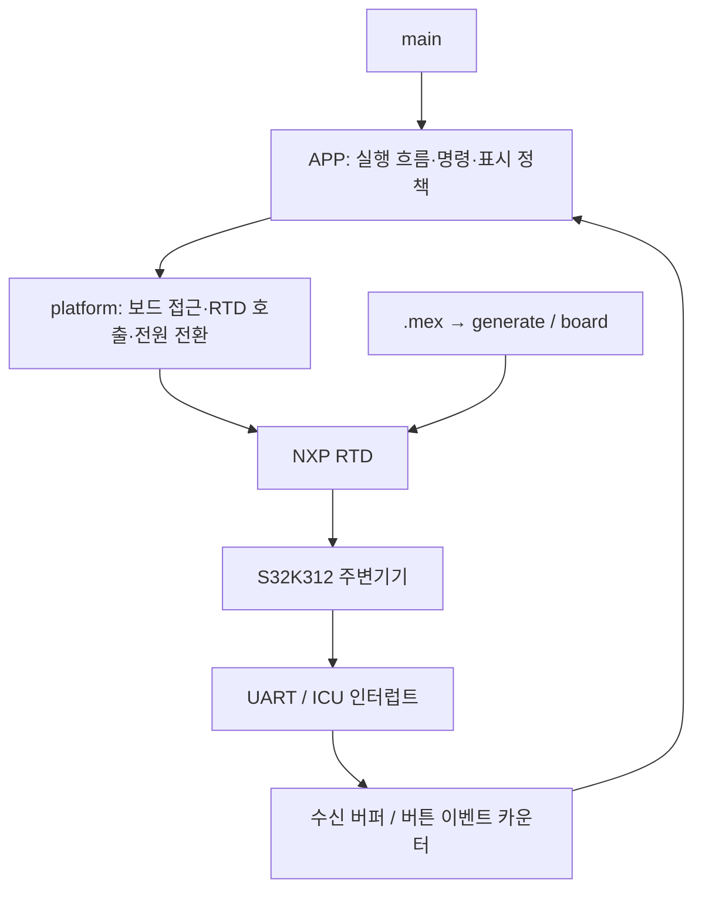

# S32K312 저전력 제어·진단 펌웨어

NXP S32K312에서 UART 명령, ADC/DMA 측정, LED/PWM 제어, Standby wakeup과 watchdog을 통합한 개인 임베디드 프로젝트입니다. RTD 주변기기 동작을 확인하는 코드에서 출발해, 애플리케이션 정책과 하드웨어 접근을 분리하고 인터럽트 처리 범위와 설정 의존성을 정리했습니다.

RTOS 없이 실행하는 **bare-metal superloop** 구조입니다. AUTOSAR 계열 RTD API를 사용하지만 AUTOSAR OS·RTE를 구성한 프로젝트는 아닙니다.

## 주요 기능

| 기능 | 구현 내용 |
|---|---|
| UART 명령 | LPUART6 인터럽트 수신, 링버퍼, 메인 루프의 명령 해석·실행 |
| ADC/DMA | 하드웨어 트리거 기반 ADC 결과 수집, non-cacheable DMA 버퍼 |
| 주기 진단 | STM0 100ms 알림을 누적한 초 단위 시간 계측, 부팅 시간·ADC 값 출력 |
| PWM | 버튼 폴링으로 0~100% 듀티를 10% 단계로 변경 |
| 색상 버튼 | ICU 콜백에서 이벤트 기록, 메인에서 OFF → GREEN → BLUE 처리 |
| Standby | 주변기기 정지, 클록 전환, PIT0 RTI·WKPU 채널 3 준비 후 저전력 진입 |
| 부팅 진단 | 초기화 전 reset/wakeup 상태 캡처, 재부팅 후 원인 출력 |
| Watchdog | 빌드 프로필에 따른 초기화·갱신·타임아웃 처리 |
| 설정 검증 | 지원하지 않는 기능 조합을 전처리 단계에서 검출 |

## 개발 환경

| 항목 | 환경 |
|---|---|
| MCU / 보드 | S32K312 / S32K312 Mini EVB 기반 |
| CPU | Arm Cortex-M7 |
| IDE | NXP S32 Design Studio 3.6.8 |
| 드라이버 | S32K3 RTD 7.0.1 |
| 컴파일러 | NXP GCC 10.2 for Arm 32-bit Bare-Metal |
| 언어 / 실행 방식 | C99 / bare-metal superloop |
| 설정 도구 | S32 Configuration Tools, 프로젝트 `.mex` |

## 설계 구조



- **APP**: 어떤 명령을 실행하고 어떤 값을 표시할지 결정합니다. `App_` 접두사를 사용합니다.
- **platform**: RTD와 보드 설정을 이용해 입출력·시간 계측·전원 전환 기능을 제공합니다. `Plat_` 접두사를 사용합니다.
- **generate / board**: Config Tools의 설정 결과를 보관합니다. 콜백 이름을 바꿀 때는 `.mex`도 함께 갱신합니다.
- **RTD**: NXP 드라이버 구현입니다. 애플리케이션 코드는 `src`에 둡니다.

계층 분리는 점진적으로 적용했습니다. 현재 색상 버튼의 DIO 제어는 APP에 남아 있고, 하드웨어 초기화 코드는 여러 주변기기의 초기화 순서를 한곳에서 조정합니다.

### 디렉터리

```text
configure_s32k312minievb/
├─ src/
│  ├─ main.c                     # App_Init / App_Process 호출
│  ├─ APP_CFG.h                  # 프로필·공통 설정·파생 옵션
│  ├─ APP_TYPE.h                 # 설정 상수
│  ├─ App_ConfigCheck.h          # 지원 조합 검증
│  ├─ APP/
│  │  ├─ App.c                   # 초기화와 superloop 실행 순서
│  │  ├─ App_Command.c           # UART 명령 파싱·실행
│  │  ├─ App_Log.c               # 로그 ON/OFF 및 문자열 출력
│  │  ├─ App_Telemetry.c         # 시간·ADC 주기 출력
│  │  ├─ App_Pwm.c               # 버튼 디바운스·듀티 단계 정책
│  │  ├─ app_color_change_btn.c  # 색상 버튼 이벤트 처리
│  │  └─ App_Standby.c           # Standby 요청·가용성 확인·로그
│  └─ platform/
│     ├─ Platform_Init.c        # RTD 초기화와 시작 순서
│     ├─ Uart_Port.c            # UART 수신 버퍼·오류 복구·송신
│     ├─ Adc_Port.c             # DMA 버퍼·ADC 완료 통지
│     ├─ Timebase.c             # STM0 기반 시간 계측
│     ├─ Pwm_Port.c             # PWM 출력
│     ├─ Button_Port.c          # 버튼 입력
│     ├─ Standby_Port.c         # 하드웨어 저전력 전환
│     └─ Wdg_Port.c             # watchdog 제어
├─ generate/                    # RTD 생성 설정
├─ board/                       # 보드 핀 설정
├─ RTD/                         # NXP 드라이버
├─ Project_Settings/            # startup·linker·debugger 설정
├─ docs/                        # 개발 중 작성한 참고 문서
└─ configure_s32k312minievb.mex  # Config Tools 설정 원본
```

## 구현에서 중점을 둔 부분

### 1. ISR과 메인 처리의 역할 분리

UART 수신 콜백은 데이터를 링버퍼에 넣고 수신을 이어갑니다. 명령 해석과 LED·Standby 실행은 메인 루프에서 수행합니다.

- 버퍼 크기 256바이트, 사용 가능 용량 255바이트
- 한 번의 명령 처리에서 최대 32바이트 소비, 명령 하나 실행
- 분할 수신된 명령은 다음 호출에서 이어서 해석
- 수신 초과·오류 횟수를 진단 API로 제공

색상 버튼 콜백은 이벤트만 기록합니다. 메인에서 한 번에 하나씩 처리하며, 최대 32개 대기 이후에는 새 이벤트를 버리고 누락 횟수를 기록합니다. UART·버튼의 일반 입력 경로에서 ISR 내부 동기 로그 송신을 제거했습니다.

### 2. DMA와 캐시를 고려한 ADC 버퍼

ADC 결과 버퍼는 `.mcal_bss_no_cacheable` 섹션에 배치하고 32바이트 정렬을 적용했습니다. DMA 콜백에서는 RTD의 완료 통지를 호출해 ADC 상태와 다음 하드웨어 트리거 처리를 이어갑니다.

앱은 `Plat_Adc_ReadRaw()`로 최신 값을 읽습니다. Telemetry는 한 번 읽은 샘플로 raw 값과 환산값을 함께 출력합니다. 현재 환산식은 `raw × 5 / 32768`이며, 실제 보드의 기준전압·ADC 설정에 맞춘 정확도 검증은 별도입니다. 최초 변환 전에는 초기값 `0xFFFF`가 읽힐 수 있습니다.

### 3. Standby 진입과 재기동 확인

```text
UART 명령
 → 진입 가능 여부 확인·로그
 → 타이머/버튼/ADC/PWM/UART 정지
 → 관련 IRQ 비활성화·pending 정리
 → Standby용 클록 설정 적용
 → WKPU 채널 3 활성화·PIT0 RTI 시작
 → wakeup 관련 비트 확인
 → Mcu_SetMode(1)
 → Standby
 → RTI wakeup
 → Reset_Handler → main → 부팅 원인 캡처
```

현재 코드의 RTI 설정은 `48,000 × 10 = 480,000 ticks`입니다. 로그는 약 10초를 표시하지만 **실제 시간은 RTI 입력 클록에 의해 결정**되므로 목표 시간의 실측·보정이 필요합니다. Standby 중 RTI 동작을 위해 SIRC 유지 설정도 필요합니다.

정상 wakeup은 기존 함수의 다음 줄로 복귀하는 흐름이 아니라 재기동 경로로 확인합니다. 초기화 전에 `MODE_STAT`, reset 원인, WKPU 상태를 저장하며, 하드웨어 준비 이후 실패하면 진행 단계를 남기고 정지합니다.

디버거 확인 변수:

```c
Plat_Standby_Stage
Plat_Standby_BootInfo
```

### 4. 기능 설정과 생성 설정의 구분

`APP_CFG.h`는 앱의 동작 옵션을, `.mex`는 RTD 하드웨어 구성을 관리합니다. 공통 값은 한 번만 정의하고 프로필마다 다른 값만 나눴습니다.

| 기본 옵션 | `BM_DEVELOPE` | `BM_RELEASE` |
|---|---|---|
| UART 명령 | ON | ON |
| UART 로그 | ON | OFF |
| ADC 디버그 변수 | ON | OFF |
| Watchdog | OFF | ON |
| Standby | ON | OFF |

Standby는 현재 watchdog과 병행하지 않도록 파생 설정합니다. ADC 구현은 DMA 방식이므로 `DMA_ENABLE`은 `ADC_ENABLE`을 따릅니다.

`BUILD_MODE`는 앱 프로필입니다. IDE의 Debug/Release 빌드 구성이나 최적화 설정과 자동으로 같은 값이 되는 것은 아닙니다. 헤더 기본값을 선택하거나 컴파일 정의로 지정합니다.

로그 조건은 `App_Log`에 모았습니다. OFF에서는 송신·포맷팅을 생략하고, Telemetry와 PWM의 로그용 계산도 건너뜁니다. 로그는 동기 송신이며 일반 작업은 메인 문맥에서 호출합니다. Watchdog 비상 콜백의 선택적 직접 송신은 기존 정책으로 남아 있습니다.

## 빌드와 실행

1. 위 버전의 S32DS와 S32K3 RTD를 설치합니다.
2. **File → Import → Existing Projects into Workspace**로 프로젝트를 가져옵니다.
3. `.mex`를 열어 설치된 SDK/RTD 연결을 확인합니다.
4. 프로젝트 include 경로의 `BASE_PLATFORMSDK_S32K3`, `PLATFORM_PLATFORMSDK_S32K3` 변수가 설치된 RTD 디렉터리로 해석되는지 확인합니다. 미해결 상태에서 `/include/`, `/header/`로 생성되면 `Std_Types.h` 등을 찾지 못합니다.
5. `src/APP_CFG.h`에서 프로필을 선택합니다. Standby 시연에는 기본 `BM_DEVELOPE`를 사용합니다.
6. 하드웨어 설정을 변경했다면 Update Code를 수행합니다. 파일 이동 이후에는 **Refresh → Clean → Build**로 빌드 목록을 갱신합니다.
7. 보드에 맞는 디버거 설정으로 다운로드하고 실행합니다.

외부에서 `.mex`를 수정한 경우에는 편집기를 디스크 내용으로 다시 불러온 뒤 사용합니다. 생성 파일을 백업할 때는 프로젝트 내부에 동일한 `.c/.h/.mex`를 그대로 복제하지 않습니다. 생성 경로 검색이나 소스 수집에 섞이지 않도록 프로젝트 외부 또는 별도 확장자로 보관합니다.

### UART 시연

터미널은 **115200 baud, 8 data bits, no parity, 1 stop bit**로 설정합니다. 현재 생성된 실제 baudrate 값은 115384입니다. LPUART6 연결 핀은 `board` 설정과 보드 회로도를 기준으로 확인합니다.

아래 명령은 숫자 값이 아닌 **ASCII 문자열**로 전송합니다. 줄바꿈은 필수가 아닙니다.

| 입력 | 동작 |
|---|---|
| `0950809` | Red LED PWM 출력을 full duty로 설정 |
| `1950808` | Standby 요청; 기본 Release에서는 실행하지 않음 |

파서는 명령 ID 한 글자와 6글자 payload를 비교합니다. 불일치하면 해당 부분 명령을 폐기하며 CRC·재전송·응답 보장은 구현하지 않았습니다.

## 현재 제약과 확장 방향

- **기능 OFF는 완전한 드라이버 제거와 다릅니다.** UART·ADC/DMA·Timebase OFF는 생성 콜백과 초기화 의존성이 남아 있어 현재 `App_ConfigCheck.h`에서 제한합니다.
- **동기 로그의 지연**이 메인 루프에 영향을 줄 수 있습니다. 다음 확장 후보는 비동기 송신 큐입니다.
- PWM 버튼 디바운스는 시간 기반이 아닌 루프 횟수 기반입니다. 색상 버튼에는 추가 소프트웨어 디바운스를 적용하지 않았습니다.
- Watchdog 갱신은 메인 루프 호출에 기반하며 태스크별 상태 감시는 없습니다. OFF는 이미 켜진 하드웨어 watchdog을 해제한다는 의미가 아닙니다.
- PLL lock 대기에 timeout이 없으며, 일부 초기화 실패는 정지 정책을 사용합니다. 공통 오류 기록·복구 정책은 추가 개선 대상입니다.
- `docs/standby-rti.md`는 초기 개발 가이드로 이전 함수명·설정값을 포함할 수 있습니다. 현재 값은 `APP_CFG.h`, `Standby_Port.h`, `.mex`와 생성 코드를 기준으로 확인합니다.


NXP RTD와 생성 코드에는 해당 파일에 명시된 NXP 라이선스 조건이 적용됩니다. 이 README는 제3자 코드의 사용·배포 권한을 변경하지 않습니다.
